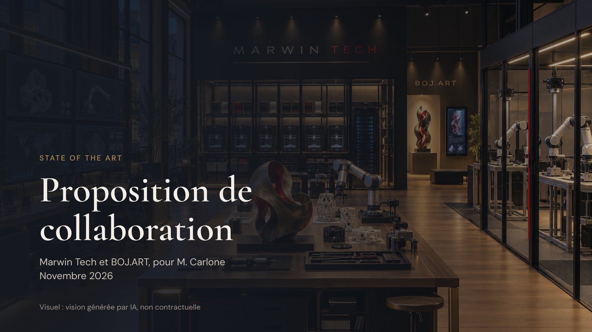

# Carlone

Tout ce qui concerne M. Carlone : l’offre de Marwin Tech, la présentation, l’audit, le catalogue d’offres du CRM, la note de vision State Of The Art et les documents sources. Copies du 4 novembre 2026.

## Le dossier

| Fichier | Contenu | Pour qui |
|---|---|---|
| [Présentation (PDF)](presentation/Offre-Marwin-Tech-pour-Carlone.pdf) | 13 diapositives : ce qui est livré, les trois volets, le premier mois, les deux formules, le paiement, STRATES, le laboratoire, les garanties, les prochaines étapes | À montrer à Carlone |
| [Offre détaillée](documents/offre-marwin-tech-remuneration-et-collaboration.md) | L’offre complète ; les sections marquées « interne » couvrent la rémunération, le plancher et la préparation du rendez-vous | Morgan et Mathys |
| [Audit](documents/audit-risques-et-solutions.md) | Verdict, atouts, matrice des risques, prix face au marché, 12 solutions, plan des 30 jours | Morgan et Mathys |
| [Catalogue d’offres du CRM](documents/offres-crm-catalogue.md) | Neuf offres de vente d’œuvres et cadre fiscal de l’article 238 bis AB | Carlone et l’équipe |
| [Note de vision State Of The Art](documents/note-de-vision-state-of-the-art.md) | Le projet commun de Medhi, Morgan, Mathys et Carlone | L’équipe |
| [Sources](sources/) | Propositions de collaboration ; Marwin Tech, choix de structure (29 octobre) ; Marwin Tech, options avantageuses (30 octobre) ; audit STRATES (2 novembre) | L’équipe |

Les images des diapositives sont dans [presentation/diapositives](presentation/diapositives/) et les schémas des documents dans [diagrammes](diagrammes/). Les fichiers de [presentation/source](presentation/source/) sont les sources HTML de la présentation en ligne ; le PDF et les images en sont un rendu local.

## Versions en ligne

Les versions de référence restent les documents en ligne, privés :

- [Présentation](https://claude.ai/artifact/1cQAdJFmYQpJQUy676NYVL)
- [Offre détaillée](https://claude.ai/artifact/G7MR3rW9P6osDQiyzxfhdM)
- [Audit](https://claude.ai/artifact/RdJ3zRdkFtxKfoFx5CeM2g)
- [Catalogue d’offres du CRM](https://claude.ai/artifact/Q7MyT5HvBoYF8xiJZhzsc1)
- [Note de vision](https://claude.ai/artifact/CUGhjw8dJa1Fsys3KG3Z4W)

## À savoir

- Les visuels de la présentation sont générés par IA : ils montrent une intention, aucune réalisation.
- Les simulations de rémunération n’ont pas été validées par un expert-comptable.
- Le CRM et les données de ses prospects restent dans le dépôt FinanceScope/CRM-Carlone ; ils ne sont pas copiés ici.
