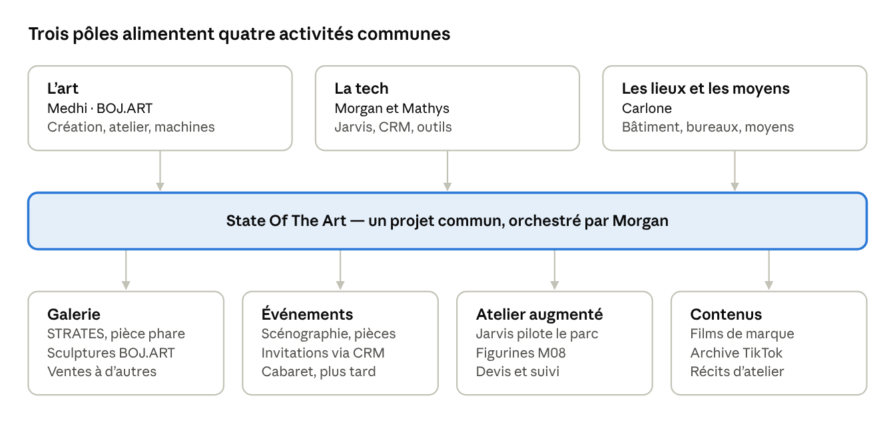
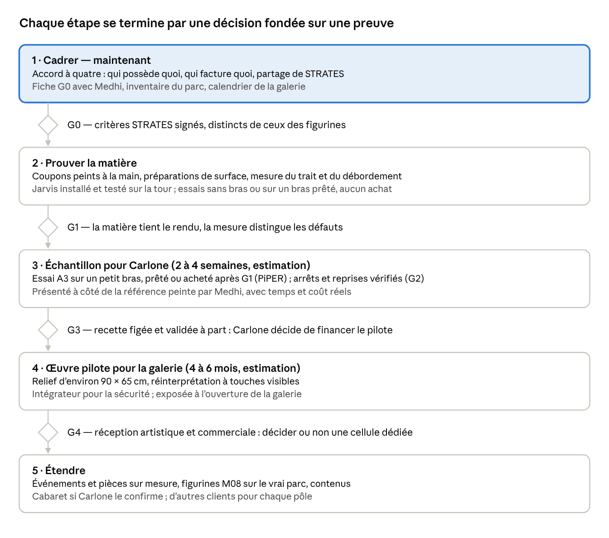

# State Of The Art — note de vision

Nov 2, 2026 · @Olsen Morgan

## L'idée en une page

State Of The Art réunit l'art de Medhi (BOJ.ART), la tech de Morgan et Mathys, et les lieux de Carlone. Le but : que chacun vive de ce qu'il aime, sainement. Première étape proposée : la Phase 1 de STRATES, une preuve de création pour la galerie de Carlone.

**Pourquoi maintenant.** Carlone, marchand d'art venu de l'avenue Montaigne et plus gros client de Morgan et Mathys, a racheté six bâtiments ; l'un deviendra une galerie d'art en 2027. Il leur propose des bureaux, une bonne rémunération, voire d'investir dans leur activité. Il prépare des événements et envisageait un cabaret. Il a déjà racheté l'ancienne affaire de Medhi et connaît BOJ.ART.

**L'idée.** Medhi crée et fabrique. Morgan et Mathys outillent l'ensemble : Jarvis pour l'atelier, le CRM pour les clients et les événements. Carlone apporte les lieux, les premières commandes et les moyens. Morgan orchestre BOJ.ART.

**La première étape.** Un échantillon de relief peint au pinceau par un bras robotisé, posé à côté d'une référence peinte à la main. Le trait est mesuré et le coût réel est connu. Ensuite seulement, on décide de l'œuvre pilote d'environ 90 × 65 cm.

## Les personnes et leurs rôles

Quatre personnes, trois pôles : l'art (Medhi), la tech (Morgan et Mathys), les lieux et les moyens (Carlone). Morgan fait le lien entre les trois.

| Personne | Rôle aujourd'hui | Ce qu'il apporte à State Of The Art |
| --- | --- | --- |
| Morgan | Associé de Mathys ; orchestre BOJ.ART ; construit Jarvis | La vision d'ensemble, Jarvis, la coordination des trois pôles |
| Mathys Couet | Associé de Morgan au quotidien ; co-auteur du CRM de Carlone | La tech et l'exploitation : CRM, outils, suivi des clients et des événements |
| Medhi | BOJ.ART est son projet (sculptures, figurines, finition) ; Morgan le connaît depuis un an et demi ; lui fait confiance pour son Jarvis | La création, l'atelier, les machines et le savoir-faire ; « plus que partant » |
| Carlone | Marchand d'art (avenue Montaigne) qui vend des œuvres avec un avantage fiscal ; plus gros client de Morgan et Mathys ; a racheté l'ancienne affaire de Medhi et six bâtiments ; connaît BOJ.ART | Une galerie d'art en 2027, des bureaux et une rémunération pour Morgan et Mathys, peut-être un investissement dans leur activité, des événements, un projet de cabaret |

Les liens existent déjà deux à deux : Carlone et Morgan/Mathys par le CRM, Carlone et Medhi par le rachat de son ancienne affaire, Medhi et Morgan par BOJ.ART et Jarvis. State Of The Art les réunit dans un seul projet.

Source : messages de Morgan du 2 novembre 2026. La structure juridique de chacun n'est pas encore précisée (voir « Décisions et informations encore attendues »).

## Ce qui existe déjà

Le logiciel est solide en démonstration et en simulation, mais rien n'est encore qualifié sur le vrai matériel : ni la tour, ni le parc, ni un bras, ni une impression. C'est la prochaine marche.

| Élément | Où on en est | Niveau de preuve |
| --- | --- | --- |
| Parc d'impression BOJ.ART | FDM et résine ; « 7–8 » puis « une dizaine » de machines citées ; modèles inconnus | Rapporté, pas d'inventaire |
| Tour Jarvis | Windows 11, Ryzen 5 5600G, 16 Go de RAM (32 Go prévus), RTX 4060 Ti 8 Go | Rapporté sur photo, pas de diagnostic |
| Jarvis M07 | Commandes vérifiées avec reçus, trois vues (atelier, Jarvis, création), dossiers CAO, Studio, Growth, mémoire citée | Tests et CI verts ; voix, écrans et machines non qualifiés |
| Modèle local de Jarvis | Profil « speed » : Qwen3.5 4B et Qwen3 Embedding 0.6B, préparé pour la 4060 Ti | Préparé, pas installé |
| Chaîne figurines M08 | Demande → modèle imprimable de 200 mm → visionneuse → tranchage, en 2 min 12 s ; estimation d'impression 12 h 16 (figurine) + 8 h 10 (socle) | Exécutée sur un personnage original ; rien imprimé ; branche non fusionnée |
| Bras peintre | 6 bras comparés ; boucle peindre → photographier → corriger ; mode haute définition | Simulation seulement ; branche non fusionnée |
| Audit STRATES | Banc d'essai ciblé avant tout achat ; trait de 7 mm, débordement ≤ 1 mm | Audit documentaire ; calculs revérifiés |
| Films | « Le dernier geste » R03 (9,25 s) ; « Veille — Un seul trait » V1 (13,67 s), direction V.02 | Coupes de travail ; aucun master approuvé, rien publié |
| Archive TikTok | 31 publications recensées, 29 vidéos sauvegardées | Archivé |
| Sites | Atelier V11 et Studio V3 | Copies classées ; visionneuse 3D de l'Atelier en panne (fichier three.js manquant) |
| CRM de Carlone | Construit par Morgan et Mathys | Rapporté ; non examiné ici |

« Branche non fusionnée » signifie que le travail est sur GitHub mais pas encore dans la version principale du dépôt. Visuels récupérés et classés le 2 novembre : 96 images et 77 vidéos créatives, 126 visuels de Jarvis.

## Ce que State Of The Art peut produire

La galerie vient en premier, avec STRATES comme pièce phare ; les événements, l'atelier augmenté et les contenus suivent.

Chaque pôle garde ses outils et ses données ; le projet commun coordonne, il ne fusionne pas. Le cabaret reste une piste tant que Carlone ne l'a pas confirmé.

## STRATES, la première pièce commune

STRATES est un relief mural en strates, peint au pinceau par un bras robotisé, pour la galerie de Carlone. L'audit du 2 novembre est favorable à un banc d'essai ciblé, pas encore à l'achat d'une cellule ni au programme R&D de 323 875 € HT chiffré dans le budget BOJART.

**Les critères de réussite proposés.** Un trait nominal de 7 mm sur un segment de 10 à 15 cm. Une largeur de 6 à 8 mm sur 90 % de la longueur. Un débordement mesuré, incertitude comprise, d'au plus 1 mm. Ces critères sont distincts de ceux des figurines (trait de 0,5 mm), qui restent une ambition de recherche.

**Ce que la simulation a appris.** Sur un coupon virtuel de 59 essais, les bras à ±0,1 mm ou mieux réussissent 52 à 58 fois, le Lite 6 seulement 26 fois. Dans le scénario pessimiste, aucun bras ne tient le millimètre. C'est donc la matière et le geste qu'il faut mesurer d'abord, pas seulement le bras.

**Le bras recommandé pour développer.** UFACTORY xArm 6 : 700 mm de portée, ±0,1 mm, environ 9 500 USD hors outillage, et déjà piloté par FRIDA, le projet de recherche le plus proche. Option économique pour un banc de coupons : AgileX PiPER, environ 2 400 €. Prix indicatifs relus le 2 novembre, hors capteur, sécurité et intégration.

**Le niveau visé.** En simulation haute définition, une œuvre du domaine public a été réinterprétée en 13 236 touches visibles. C'est le niveau visé pour l'œuvre pilote : une réinterprétation à touches visibles, pas une copie. Durée de bras estimée : 6 à 9 h, une hypothèse et non une mesure.

**Ce qu'il faut montrer à Carlone.**

1. Un échantillon peint par le bras, posé à côté d'une référence peinte à la main par Medhi.
2. La mesure du trait et du débordement, avec son incertitude.
3. Le temps et le coût réels de l'échantillon.
4. Le rendu simulé de l'œuvre complète, présenté comme une simulation.
5. La décision demandée : financer l'œuvre pilote, avec des critères d'acceptation écrits ensemble.

Deux points à trancher : le format (90 × 65 cm dans l'audit, 90 × 56 cm dans la simulation) et le motif. Le motif doit être une création de Medhi ou une œuvre du domaine public : aucune œuvre protégée sans accord écrit.

## Vivre de ce qu'on aime, sainement

Pour que le projet dure, chacun doit savoir ce qu'il possède, ce qu'il facture et ce qu'il décide, avant que l'argent arrive.

- **Qui possède quoi, par écrit.** La marque BOJ.ART et les œuvres : Medhi. Le code de Jarvis et du CRM : Morgan et Mathys, dans une structure à préciser. Les lieux : Carlone. Un accord simple suffit pour commencer.
- **Une facture par activité.** Le CRM et l'exploitation pour Carlone, les œuvres BOJ.ART, Jarvis pour l'atelier : trois relations distinctes. Morgan travaille pour Carlone et lui proposera des œuvres ; séparer les deux garde la confiance intacte.
- **Un projet commun, un partage écrit.** Pour STRATES et les suivants, fixer avant de commencer qui touche quoi : création, fabrication, tech, lieu.
- **Trois validations indépendantes.** Technique (ça tient), artistique (Medhi valide la finition), commerciale (le client accepte). Une impression réussie ne vaut pas une œuvre vendue.
- **Pas un seul client.** Carlone lance le projet, mais la galerie, l'atelier et l'activité tech doivent aussi vendre à d'autres. Fixer une part maximale de revenus venant de Carlone.
- **Un rythme tenable.** Des étapes courtes avec un résultat montrable. L'urgence ne vaut ni budget illimité ni achat. Temps humain et temps machine sont comptés séparément.
- **Chacun garde ses données.** Les informations de Carlone restent privées et hors du dépôt public BOJART. Chaque pôle garde ses propres outils ; State Of The Art les coordonne sans les fusionner.

## Feuille de route

Cinq étapes, chacune fermée par une décision fondée sur une preuve. La première, cadrer, commence maintenant et ne coûte presque rien.

Les durées viennent de la session sur le bras peintre : ce sont des estimations, pas des devis. La galerie ouvrira en 2027, date exacte à fixer : si le cadrage commence maintenant, l'œuvre pilote peut viser l'ouverture.

## Risques et garde-fous

Le risque principal n'est pas l'argent : c'est un échec visible devant Carlone, ou un projet qui mélange les rôles au point d'user la confiance.

| Risque | Ce qui le réduit |
| --- | --- |
| Un essai raté montré à Carlone | Ne montrer qu'après des coupons mesurés (G1) ; présenter toute simulation comme une simulation |
| Rôles et argent mélangés entre les quatre | Contrats et factures séparés ; partage écrit pour chaque projet commun ; transparence sur les liens existants (CRM, rachat de l'affaire de Medhi) |
| Dépendre d'un seul client | Part maximale de revenus venant de Carlone ; d'autres acheteurs pour la galerie, d'autres clients pour la tech |
| Droits d'auteur | Créations originales ou œuvres du domaine public ; accord écrit sinon. Jarvis bloque déjà les personnages protégés (cas Végéta) |
| Sécurité d'un bras en galerie, près du public | Intégrateur compétent ; norme ISO 10218-2:2025 ; règlement machines (UE) 2023/1230 applicable au 20 janvier 2027 |
| Matériel jamais qualifié (tour, parc, voix) | Inventaire du parc et recette sur place avant toute promesse de délai |
| Programme R&D surdimensionné | Financer par livrables (banc, échantillon, pilote) plutôt que 323 875 € d'un coup |
| Trop de chantiers à la fois | Un projet commun à la fois : STRATES d'abord, la galerie ensuite, le cabaret plus tard |
| Données de Carlone exposées | Rien sur lui dans le dépôt public BOJART ; documents privés seulement |

**Trois risques ajoutés le 2 novembre**, après l'étude des offres de Carlone (Offres de Carlone — catalogue pour le CRM) :

- **Les pièces faites à la machine** (impression 3D, bras peintre, donc STRATES) ne sont très probablement pas des « œuvres originales » au sens fiscal. Elles ne passent pas par l'offre de déduction de Carlone sans prise de position écrite de l'administration ; les pièces faites entièrement à la main par Medhi, si.
- **Un investissement de Carlone dans Morgan et Mathys** : faire rédiger un pacte avant de signer (part, gouvernance, propriété du code du CRM et de Jarvis, sortie).
- **Le dépôt du CRM de Carlone est public** sur GitHub et expose des données personnelles de prospects : le passer en privé sans attendre.

## Décisions et informations encore attendues

Treize points débloquent la suite ; les quatre premiers conditionnent la présentation à Carlone.

- [ ] Motif et format de STRATES (90 × 65 ou 90 × 56 cm), choisis avec Medhi : c'est la fiche G0
- [ ] Calendrier : ouverture de la galerie et prochain rendez-vous avec Carlone
- [ ] Enveloppe que Carlone est prêt à engager pour la Phase 1
- [ ] Partage écrit pour STRATES : création, fabrication, tech, lieu
- [x] Structure qui porte l'activité de Morgan et Mathys : Marwin Tech, OLSEN ou une autre (le dépôt cite « Marwin Tech » et « Marwin Studio »)
- [ ] Forme de State Of The Art : marque commune, association, société ? ont sait pas enccore;
- [ ] Rôle de Mathys dans BOJ.ART et dans State Of The Art tout comme moi
- [ ] Le cabaret est-il toujours d'actualité ? ou
- [ ] Part maximale des revenus qui peut venir de Carlone ( 10 millions
- [ ] Inventaire du parc de Medhi : modèles, volumes, matières à faire
- [ ] Les trois documents internes (proposition STRATES v1.1, dossier investisseur, budget) et la conversation « Bras robotique précis », encore dans la bibliothèque ChatGPT
- [ ] Fusion dans la version principale des branches M08, bras peintre et Veille
- [ ] Lieu privé pour les originaux : PDF STRATES, vidéos, rapports V5

## Sources et niveau de preuve

Toutes les sources ont été lues le 2 novembre 2026. « Rapporté » veut dire dit ou écrit, sans vérification sur place ; « simulé » veut dire calculé sans matériel réel.

| Source | Ce qu'elle établit | Niveau |
| --- | --- | --- |
| Messages de Morgan, 2 novembre | Rôles, liens avec Carlone, galerie, bureaux, cabaret, nom State Of The Art | Rapporté |
| PDF « STRATES : verdict de l'audit » (12 pages, privé) et sa [synthèse publique](https://github.com/Momolscode/BOJART/blob/main/docs/research/strates-robotique-2026-11-02/README.md) | Verdict, critères, jalons G0–G4, budget R&D | Audit documentaire |
| [Recalcul des chiffres de l'audit](https://github.com/Momolscode/BOJART/blob/main/docs/research/strates-robotique-2026-11-02/verification-calculs.json) | Bornes statistiques, budget d'erreur, sommes du budget | Vérifié par calcul |
| [Simulation du bras peintre](https://github.com/Momolscode/BOJART/blob/claude/project-thread-itvloj/docs/research/bras-peintre-simulation-2026-11-02/README.md) | Comparatif de 6 bras, coupon virtuel, rendu haute définition | Simulé |
| [Chaîne figurines M08](https://github.com/Momolscode/BOJART/blob/claude/project-thread-2dh4hm/jarvis/docs/m08/RELEASE_M08.md) | Demande → modèle imprimable → tranchage | Exécuté en conteneur, pas imprimé |
| [Recette « Veille — Un seul trait »](https://github.com/Momolscode/BOJART/blob/claude/project-thread-y7r3jh/productions/veille-un-seul-trait/README.md) | Film V1 de la direction V.02 | Coupe de travail |
| [État courant de Jarvis](https://github.com/Momolscode/BOJART/blob/main/context/CURRENT.md) et [direction créative](https://github.com/Momolscode/BOJART/blob/main/creative/CURRENT.md) | Logiciel, films, sites, limites | Tests et CI ; rien qualifié sur place |
| [Poste RTX 4060 Ti](https://github.com/Momolscode/BOJART/blob/main/docs/memory/POSTE_RTX4060TI.md) | Matériel de la tour, profil de modèle | Rapporté sur photo |
| [Données terrain à préparer](https://github.com/Momolscode/BOJART/blob/main/docs/research/audit-transversal-2026-11-02/donnees-terrain.txt) | Fiches machines, trois validations, archive TikTok | Gabarits historiques |
| Invitation GitHub au dépôt FinanceScope/CRM-Carlone (Gmail, 22 octobre) | Existence du dépôt du CRM | Non examiné |

Non consultés, car inaccessibles d'ici : la proposition STRATES v1.1, le dossier investisseur, le budget et la conversation « Bras robotique précis ».
