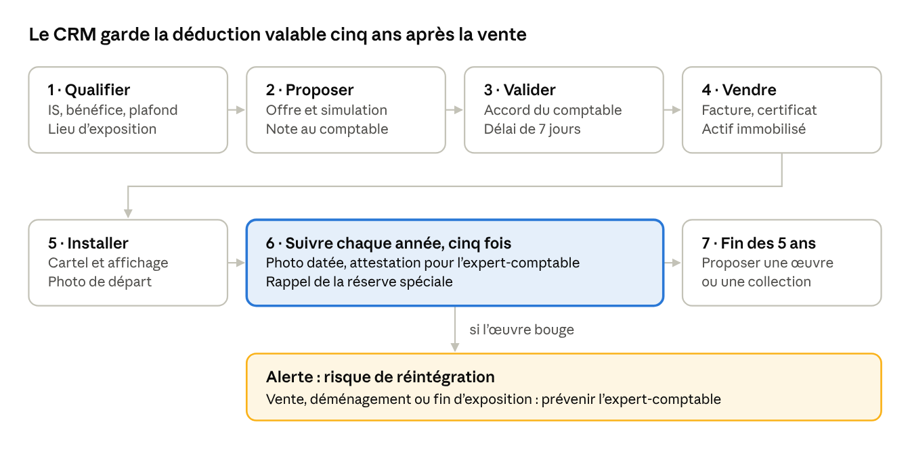

# Offres de Carlone — catalogue pour le CRM

Nov 2, 2026 · @Olsen Morgan

## L'essentiel

Carlone vend des œuvres d'art avec un avantage fiscal. Ce document propose ses offres sous une forme prête à saisir dans son CRM, chacune avec sa cible, son mécanisme et son suivi.

**Le contexte.** Marchand d'art venu de l'avenue Montaigne à Paris, Carlone a déjà racheté six bâtiments et ouvrira une galerie en 2027. Morgan et Mathys lui ont construit un CRM. Il propose de leur fournir des bureaux, une bonne rémunération, et envisage d'investir dans leur activité.

**Le principe.** Une offre fiscale sur l'art ne vaut que si ses conditions légales sont tenues pendant toute la durée de l'avantage. Le CRM devient alors l'outil qui prouve ces conditions année après année : c'est ce qui le distingue d'un simple fichier clients.

**À valider.** Les règles fiscales ci-dessous sont relues sur les textes officiels, mais ce document n'est pas un conseil fiscal. Chaque offre doit être validée par l'expert-comptable ou l'avocat fiscaliste de Carlone avant d'être vendue.

## Le cadre fiscal vérifié

Une entreprise qui achète une œuvre originale d'un artiste vivant peut déduire son prix sur cinq ans, à condition de l'exposer au public. Le dispositif vaut pour les achats réalisés avant le 31 décembre 2028 (article 238 bis AB du CGI, prolongé par la loi de finances pour 2026).

| Condition | Règle | BOFiP |
| --- | --- | --- |
| Qui | Sociétés à l'IS, de plein droit ou sur option, et sociétés de personnes ; professions en BNC exclues | § 5 |
| Quelle œuvre | Œuvre originale au sens de l'article 98 A, II de l'annexe III du CGI ; artiste vivant au jour de l'achat | § 10 à 30 |
| Comptabilité | Œuvre inscrite à l'actif immobilisé, jamais en stock | § 40 |
| Déduction | Un cinquième du prix par an, sur l'exercice d'achat et les quatre suivants, sans prorata ; frais accessoires exclus | § 170, 200 |
| Plafond annuel | 20 000 €, ou 5 ‰ du chiffre d'affaires HT si c'est plus, moins les dons de mécénat de l'année ; l'excédent est perdu | § 220 |
| Réserve spéciale | Montant déduit placé dans une réserve spéciale au passif, au plus tard à la clôture de l'exercice suivant | § 120 |
| Exposition | Gratuite, dans un lieu accessible au public ou aux salariés, jamais un bureau, pendant les cinq exercices ; le public doit être informé | § 80 à 100 |
| Remise en cause | Réintégration immédiate en cas de vente, d'arrêt d'exposition ou de prélèvement sur la réserve | § 240 à 270 |

**Ce que « œuvre originale » exclut.** Une peinture doit être exécutée entièrement à la main par l'artiste. La doctrine exclut « tout procédé, quel qu'il soit, permettant de suppléer, en tout ou en partie, à cette intervention humaine ». Une sculpture doit être exécutée entièrement par l'artiste ; une fonte est limitée à 8 exemplaires et une photographie à 30 exemplaires signés et numérotés.

**L'économie réelle.** La déduction réduit le bénéfice imposable, donc l'impôt, seulement si l'entreprise est bénéficiaire. Au taux normal de l'IS de 25 %, une déduction de 20 000 € économise 5 000 € d'impôt ; au taux réduit des PME de 15 %, 3 000 €.

**Les particuliers.** Ce dispositif ne les concerne pas. On leur vend une œuvre, sans argument de défiscalisation ; leurs questions patrimoniales relèvent de leur conseiller.

## Le catalogue d'offres

Neuf offres en quatre familles : entreprises, suivi, artistes et galerie 2027. Une seule est déjà dans le CRM : l'achat d'une œuvre exposée, avec sa simulation et son mémo d'appel.

| Offre | Pour qui | Contenu | Avantage pour le client | Modèle de prix | Statut |
| --- | --- | --- | --- | --- | --- |
| 1. Œuvre exposée | Sociétés à l'IS bénéficiaires, avec un espace ouvert au public ou aux salariés | Une œuvre originale d'artiste vivant, livrée, installée, avec son cartel | Déduction sur cinq ans dans le plafond ; un lieu valorisé | Prix de l'œuvre, au plus cinq fois le plafond annuel du client | Dans le CRM |
| 2. Collection d'entreprise | Grands comptes (plafond au-dessus de 20 000 €, soit plus de 4 M€ de CA) et groupes à plusieurs sites | Trois à cinq œuvres, un plan d'accrochage par site | Utilise tout le plafond ; image de marque | Somme des œuvres, répartie sur plusieurs exercices | À construire |
| 3. Commande sur mesure | Entreprises avec un hall, un showroom ou un accueil | Une œuvre créée à la main pour le lieu par un artiste vivant | Pièce unique ; déduction si l'œuvre est originale au sens fiscal | Devis de l'artiste, acompte, solde à la livraison | À construire |
| 4. Suivi sur cinq ans | Tout acheteur des offres 1 à 3 | Information du public, photo datée chaque année, attestation pour l'expert-comptable, rappel de la réserve spéciale, alerte en cas de déménagement | Garde la déduction acquise et fournit la preuve en cas de contrôle | Forfait annuel, ou inclus dans le prix | À construire |
| 5. Vernissage en entreprise | Acheteurs et prospects chauds | Soirée avec l'artiste dans les locaux du client, invitations envoyées depuis le CRM | Fait vivre l'œuvre et documente son exposition au public | Forfait par événement | À construire |
| 6. Programme artistes | Artistes vivants, dont les 97 déjà repérés dans l'onglet Culture | Convention de dépôt, assurance, partage du prix convenu, ventes aux entreprises | Un débouché régulier | Commission sur vente ; jamais de loyer facturé à l'artiste | À construire |
| 7. Cercle des collectionneurs fondateurs | Dirigeants et collectionneurs, avant l'ouverture | Avant-premières, réservations d'œuvres, invitation à l'ouverture | Accès en premier aux œuvres et aux événements | Adhésion ou gratuit, à décider | Pour 2027 |
| 8. Privatisation et événements | Entreprises et particuliers | Espaces de la galerie et des bâtiments pour vernissages privés, séminaires, soirées | Un lieu d'exception | Tarif par événement | Pour 2027 |
| 9. Collectionneur particulier | Particuliers | Conseil, sélection, livraison, certificat d'authenticité | Une œuvre choisie avec un expert ; aucun argument fiscal | Prix de l'œuvre | À construire |

Les prix ne sont pas fixés ici : ils dépendent des œuvres et des artistes que Carlone réunira. Les textes destinés aux entreprises gardent la règle déjà inscrite dans le CRM : ne citer ni Le Vieux Relais ni le M.

## Un exemple chiffré

Une PME réalisant 2 M€ de chiffre d'affaires peut déduire jusqu'à 20 000 € par an : une œuvre de 100 000 € au plus est entièrement déductible en cinq ans.

| Entreprise (CA HT) | Plafond annuel | Prix maximal déductible en 5 ans | Économie d'IS maximale à 25 % |
| --- | --- | --- | --- |
| 1 M€ | 20 000 € (5 ‰ = 5 000 €) | 100 000 € | 25 000 € |
| 2 M€ | 20 000 € (5 ‰ = 10 000 €) | 100 000 € | 25 000 € |
| 10 M€ | 50 000 € | 250 000 € | 62 500 € |
| 40 M€ | 200 000 € | 1 000 000 € | 250 000 € |

**Une œuvre de 30 000 € dans la PME à 2 M€.** Déduction de 6 000 € par an pendant cinq ans. À 25 %, l'impôt baisse de 1 500 € par an, soit 7 500 € au total : coût net de 22 500 €, à condition que l'entreprise reste bénéficiaire. Au taux réduit de 15 %, l'économie tombe à 4 500 €.

Ces montants supposent qu'aucun don de mécénat ne réduise le plafond la même année. Ils reprennent le calcul déjà codé dans le CRM (plafond, prix maximal, économie) et ne remplacent pas la validation de l'expert-comptable.

## Comment le CRM suit une vente sur cinq ans

La vente n'est que la quatrième étape sur sept : la valeur du CRM est dans les cinq années de suivi qui gardent la déduction valable.

Chaque année de suivi est aussi une occasion de contact. À la fin des cinq ans, le client a déjà l'habitude d'acheter : c'est le moment de proposer une nouvelle œuvre.

## Ce que le CRM doit contenir

Le CRM sait déjà trouver et appeler les entreprises ; il lui manque de quoi vendre plusieurs offres et suivre chaque vente pendant cinq ans.

**Déjà en place** (dépôt FinanceScope/CRM-Carlone, branche de travail du 30 octobre) : 500 entreprises de la Nièvre classées et réparties en vagues ; plafond, prix maximal et économie calculés par entreprise ; simulation à trois prix ; mémo d'appel avec discours, objections et cadre légal ; note pour l'expert-comptable ; refus de prospection ; onglet Culture avec 97 artistes ; liaison avec Hermes360 ; version autonome sur Firebase.

**À ajouter**

- **Une fiche Offre** : les neuf offres du catalogue, avec cible, contenu, modèle de prix et textes de vente validés.
- **Une fiche Œuvre** : artiste, artiste vivant à la date d'achat, catégorie au sens de l'article 98 A, technique (à la main ou non), numéro d'exemplaire, prix, certificat.
- **Une fiche Vente** : entreprise, œuvre, date d'achat, exercice de départ, plan de déduction sur cinq ans, lieu d'exposition et preuve d'information du public.
- **Des tâches automatiques** : chaque année, photo datée de l'œuvre en place, attestation pour l'expert-comptable et rappel de la réserve spéciale.
- **Des alertes** : déménagement, revente ou fin d'exposition (risque de réintégration) ; fin de la période de cinq ans (proposer une nouvelle œuvre) ; achèvement du dispositif pour les achats faits avant le 31 décembre 2028.
- **Le nom de la structure qui vend** : le CRM le laisse « à compléter » dans chaque mail ; il faut le décider.

## Garde-fous juridiques

Trois règles évitent l'essentiel des risques : ne jamais promettre de rendement, ne présenter comme déductibles que des œuvres faites à la main, prouver l'exposition chaque année. Une quatrième est urgente : le dépôt du CRM est public.

- **Urgent : le dépôt du CRM est public.** FinanceScope/CRM-Carlone est visible par tout le monde sur GitHub. Sa branche de travail contient 931 numéros de téléphone, 206 adresses e-mail, 63 fichiers avec des profils LinkedIn de décideurs, la stratégie commerciale et le rapport destiné à Carlone. Ce sont des données personnelles : passer le dépôt en privé sans attendre (Settings, Danger Zone, Change visibility), puis vérifier qu'aucune copie publique n'existe.
- **Aucune promesse de rendement.** Parler d'économie d'impôt encadrée, jamais de placement, de plus-value ou de revente. Mettre en avant un rendement financier, proposer une reprise avec revalorisation ou gérer les œuvres pour le client fait entrer l'offre dans le régime des intermédiaires en biens divers. Il faut alors un dossier préalable à l'AMF avant toute prospection, avec une contribution de 8 000 €.
- **Une œuvre vraiment originale.** Pour chaque œuvre, vérifier : faite à la main, artiste vivant, exemplaires limités. En cas de doute (impression 3D, peinture au robot, procédé numérique), ne pas promettre la déduction ; demander d'abord une prise de position écrite de l'administration (rescrit).
- **Le bon lieu d'exposition.** Jamais un bureau. Exposer dans un lieu tiers, par exemple la galerie ou un établissement de Carlone, une œuvre achetée par une entreprise n'est pas explicitement prévu par le BOFiP : à faire valider, comme le CRM le note déjà.
- **Des preuves chaque année.** Information du public, photo datée, réserve spéciale : sans elles, la déduction peut être remise en cause lors d'un contrôle.
- **Les petites entreprises.** Une vente conclue hors établissement avec une entreprise de 5 salariés au plus suit des règles protectrices : délai de rétractation, aucun paiement avant 7 jours. Le CRM l'affiche déjà.
- **La prospection.** Respecter les oppositions, proposer « STOP », n'utiliser que des coordonnées professionnelles publiées : règles déjà en place dans le CRM.

## Le lien avec BOJ.ART et State Of The Art

Les œuvres de BOJ.ART peuvent entrer au catalogue de Carlone, mais pas toutes avec l'avantage fiscal : ce qui est fait à la machine en est très probablement exclu.

- **Pièces faites entièrement à la main par Medhi** (sculpture modelée ou taillée, peinture à la main), en pièce unique ou en tirage limité : elles peuvent servir les offres 1 à 3, artiste vivant obligé.
- **Pièces imprimées en 3D ou peintes par le bras robotisé**, dont STRATES : la doctrine exclut tout procédé qui remplace la main de l'artiste, même en partie. Elles se vendent sans argument de déduction (offres 7 à 9), ou après un rescrit favorable.
- **Conséquence pour STRATES** : sa valeur est artistique et d'image, pas fiscale. L'échantillon peint à la main par Medhi, prévu à côté de l'échantillon robotisé, peut en revanche être proposé aux entreprises.
- **Le relais entre les outils** : une commande sur mesure signée dans le CRM (offre 3) peut ouvrir un dossier dans le Jarvis de l'atelier. Les deux outils échangent la commande, pas leurs données clients.

Ce point est reporté dans les risques de la note de vision State Of The Art : la galerie et le canal fiscal de Carlone ne vendent pas les mêmes pièces.

## Questions à poser à Carlone

Dix réponses suffisent pour transformer ce catalogue en offres vendables.

- [ ] Au nom de quelle structure les œuvres sont-elles vendues ? Le CRM attend ce nom dans chaque mail et au téléphone.
- [ ] Quels artistes et quelles œuvres sont disponibles, avec leur technique, leur nombre d'exemplaires et leur prix ?
- [ ] Quelle fourchette de prix vise-t-il pour une entreprise de la Nièvre ?
- [ ] Le suivi sur cinq ans est-il facturé à part ou inclus dans le prix ?
- [ ] Qui est son expert-comptable ou son avocat fiscaliste pour valider les textes ?
- [ ] Vend-il déjà à Paris avec cet argument ? Si oui : contrats types, objections fréquentes, clients satisfaits.
- [ ] Propose-t-il ou souhaite-t-il proposer une reprise, un rachat ou une revente des œuvres ? Si oui : avis juridique avant tout (régime biens divers).
- [ ] Veut-il aussi louer des œuvres aux entreprises ? C'est un autre mécanisme fiscal, non étudié ici.
- [ ] Pour la galerie 2027 : quels bâtiments, quelles dates, quel public visé ?
- [ ] Le dépôt du CRM peut-il passer en privé aujourd'hui ?

## Sources

Pages officielles ouvertes le 2 novembre 2026, sauf mention contraire.

- [BOI-BIC-CHG-70-10, version du 15 avril 2026](https://bofip.impots.gouv.fr/doctrine/pgp/1801-PGP) : conditions, plafond, réserve, exposition, réintégration (§ cités dans le tableau).
- [Actualité BOFiP du 15 avril 2026](https://bofip.impots.gouv.fr/node/377599) : prolongation aux achats réalisés avant le 31 décembre 2028 par l'article 89 de la loi de finances pour 2026.
- [BOFiP archives, fiche 3K1121 (1995)](https://bofip-archives.impots.gouv.fr/bofip/32848-AIDA.html/identifiant=3K1121-19950815) : peintures « entièrement exécutées à la main par l'artiste », exclusion des procédés qui remplacent la main. Doctrine archivée : à confirmer sur le texte en vigueur de l'article 98 A.
- [AMF, intermédiaire en biens divers](https://www.amf-france.org/fr/espace-professionnels/autres-profils/intermediaire-en-biens-divers) : critères (rendement mis en avant, gestion par le vendeur, reprise avec revalorisation), dossier préalable, contribution de 8 000 €.
- Seuils de 8 fontes et 30 photographies : relevés dans des sources secondaires, à vérifier sur Légifrance.
- Dépôt FinanceScope/CRM-Carlone, branche de travail au commit b53a81c : passation, calcul du plafond, consignes de prospection, règles déjà intégrées.
- Messages de Morgan du 2 novembre 2026 : activité et projets de Carlone.
