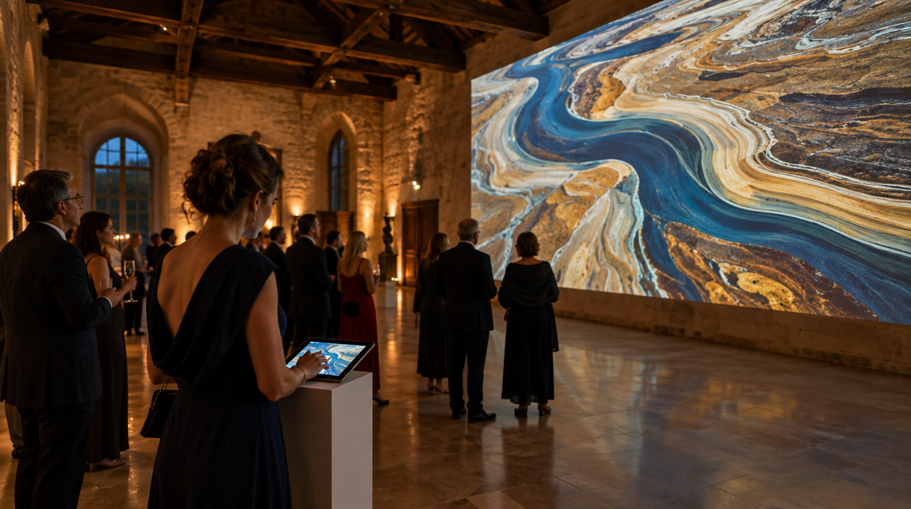
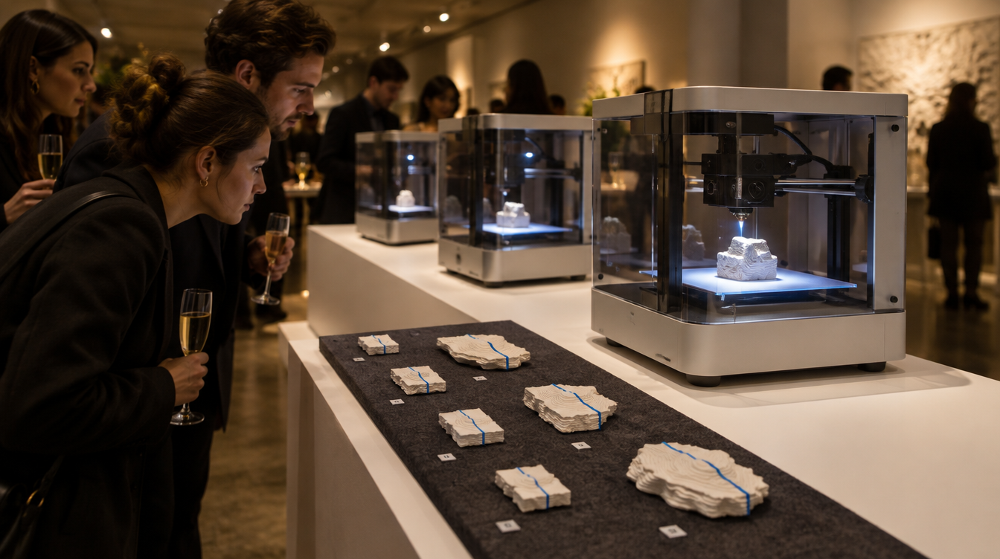
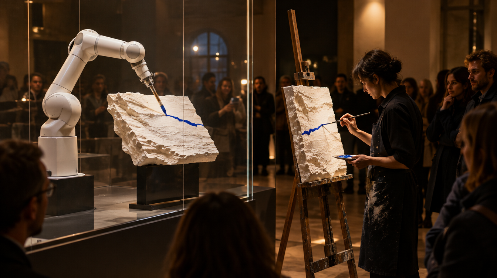
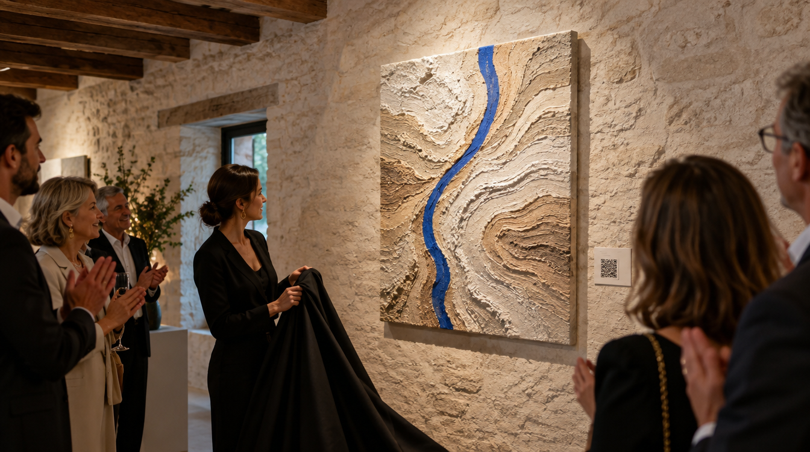
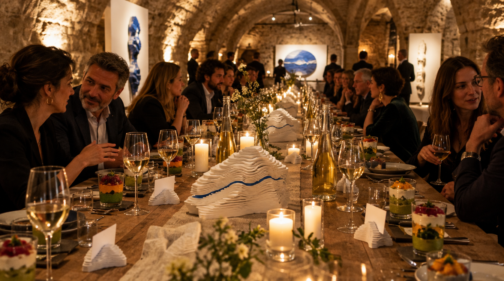
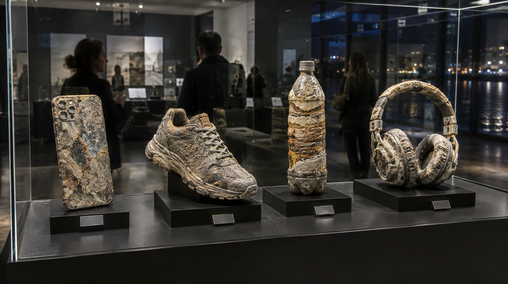

# Vernissage « Strates » — un événement à ajouter à l'offre

Nov 4, 2026 · @Olsen Morgan

Une soirée qui montre une œuvre dans tous ses états : imaginée par l'IA, construite couche par couche par les imprimantes 3D, peinte par le bras et par la main de Medhi, puis dévoilée dans un lieu de Carlone. Elle peut entrer dans l'offre Marwin Tech dès la formule de base.

## L'idée directrice

Un seul mot relie les quatre univers : les strates. Celles de la Loire, que STRATES évoque. Celles de l'impression 3D, qui fabrique couche par couche. Celles de la peinture, posée passe après passe par le bras puis par la main.

La soirée fait traverser ces strates dans l'ordre où l'œuvre naît : l'idée, la matière, le geste, l'œuvre, puis la table. Chaque univers a sa salle, et l'invité repart avec un morceau de l'œuvre.

Le point de départ est le rapport « Fusion des univers » du 4 novembre : ses idées sont reprises ici sous une forme réalisable avec ce qui existe déjà. Cela comprend le parc d'impression de Medhi, Jarvis, le CRM, les films et, une fois testé, le bras peintre.

## Le parcours de la soirée

Cinq temps, de l'entrée à la table ; chacun mêle au moins deux univers.

1. **La source : l'IA imagine.** À l'entrée, une projection murale de la Loire, générée par IA, évolue au fil de la soirée. Chaque invité y dépose un mot ou une couleur sur une tablette, et l'image change.
2. **Couche par couche : les machines construisent.** Trois ou quatre imprimantes du parc de Medhi impriment des fragments du relief de STRATES. La plupart sont imprimés à l'avance ; les machines en terminent quelques-uns sous les yeux des invités. Chaque fragment est numéroté, et l'invité repart avec le sien.
3. **Le geste : la main et la machine.** Derrière une vitre, le bras peint le trait bleu sur un échantillon. À côté, Medhi peint le même trait à la main. Les invités comparent les deux.
4. **L'œuvre : le dévoilement.** STRATES est découverte, entourée des pièces de Medhi. Chaque œuvre porte un cartel parlant : un QR code fait entendre l'intention de l'artiste.
5. **La table : les strates se dégustent.** Dîner ou cocktail aux vins de Loire. Le décor est imprimé en 3D (porte-noms, centres de table en strates) et le service se fait en verrines à couches.

Le lendemain, chaque invité reçoit par le CRM le film de la soirée et la photo de son fragment. Les entreprises intéressées entrent dans le suivi des ventes.

## À quoi ça peut ressembler

Six visuels des moments forts, générés par IA le 4 novembre : ce sont des intentions, pas des photos, et rien de ce qu'ils montrent n'est encore fabriqué. Les lieux sont imaginaires, ils ne représentent pas les bâtiments de Carlone.

**1. La source.** La Loire projetée en strates ; une invitée y ajoute sa couleur depuis la tablette.

**2. Couche par couche.** Les imprimantes terminent des fragments ; les fragments numérotés attendent leurs propriétaires.

**3. La main et la machine.** Le bras peint le trait bleu derrière la vitre ; à côté, l'artiste peint le même à la main.

**4. Le dévoilement.** Le relief apparaît sous la lumière rasante, avec son cartel parlant.

**5. Le dîner des strates.** Centres de table et porte-noms imprimés en 3D, verrines à couches, vins de Loire.

**6. Les fossiles de la Loire.** Téléphone, basket, bouteille et casque, « retrouvés dans la Loire en l'an 5000 ».

## Les idées une par une

Onze idées, dont huit faisables dès maintenant avec le parc de Medhi, l'IA et le CRM ; celles qui font travailler le bras attendent son premier essai.

| Idée | Ce que vit l'invité | Univers mêlés | Faisable |
| --- | --- | --- | --- |
| Fragments numérotés | Il voit imprimer un morceau du relief et repart avec, numéroté | Impression 3D, art | Oui, avec le parc de Medhi |
| Fossiles de la Loire | Une vitrine d'objets « retrouvés dans la Loire en l'an 5000 », imaginés par IA et imprimés en résine, présentés comme dans un muséum | IA, impression 3D, art | Oui, préparé avant la soirée |
| La Loire vivante | Une projection qui change avec les mots et les couleurs déposés par les invités | IA, scénographie | Oui, en version simple |
| Cartel parlant | Un QR code fait entendre l'intention de l'artiste, écrite et validée par lui | IA, art | Oui |
| Portrait-relief | Sur volontariat, sa photo devient un petit relief dans le style de STRATES, livré une semaine après | IA, impression 3D, art | Oui, en différé |
| Socles tournants | Les sculptures tournent lentement sur des plateaux motorisés | Robotique, scénographie | Oui |
| Film de fabrication | Projection du film de l'œuvre, du motif au dernier trait | IA, vidéo, art | Oui ; les films actuels sont des concepts générés par IA, à présenter comme tels |
| Dîner des strates | Décor imprimé en 3D, verrines à couches, vins de Loire | Impression 3D, restauration | Oui |
| Le trait en direct | Le bras peint un trait bleu derrière une vitre | Robotique, art | Après le premier essai du bras (phase 1 de STRATES) |
| La main et la machine | Medhi peint le même trait à la main, à côté du bras | Art, robotique | Après la phase 1 |
| Duo de cabaret | Un danseur et le bras en mouvement lent, séparés par une protection | Robotique, spectacle | Plus tard, pour le projet de cabaret |

Les trois idées les plus fortes pour un premier vernissage : les fragments numérotés (chacun repart avec l'œuvre), les fossiles de la Loire (l'IA rendue tangible) et la main et la machine (le cœur de STRATES).

## D'autres idées

Dix idées de plus. Deux changent la donne. Le traceur donne une machine qui dessine dès le premier format, sans attendre le bras. Les carottes de la Loire font de chaque invité le propriétaire d'une strate unique.

| Idée | Ce que vit l'invité | Univers mêlés | Faisable |
| --- | --- | --- | --- |
| Le trait de tous | Il trace une ligne sur une tablette ; un traceur (une petite machine à dessiner) la reporte sur une grande feuille commune. En fin de soirée, l'œuvre collective est signée par tous, puis offerte à la galerie ou mise aux enchères | Robotique, art | Oui, sans risque pour le public |
| Carottes de la Loire | Il choisit un mot ; la machine en tire une séquence de couleurs et imprime une « carotte » cylindrique en strates, unique, qu'il emporte | Impression 3D, IA, art | Oui, imprimées pendant la soirée ou avant |
| Lumière rasante | Une lumière motorisée tourne lentement autour de STRATES : les ombres des strates bougent comme l'eau | Robotique, scénographie | Oui |
| Le mur des essais | Les impressions ratées et les échantillons d'essai, encadrés comme des œuvres : les brouillons de la machine | Art, impression 3D, robotique | Oui |
| Strates sonores | Une bande-son mêle l'eau de la Loire, le chant des imprimantes et le frottement du pinceau | IA, son | Oui |
| Cocktail stratifié | Un barman monte un cocktail en couches, servi avec un mélangeur imprimé en 3D portant le trait bleu | Restauration, impression 3D | Oui |
| Invitation-objet | L'invitation arrive sous forme d'un petit jeton imprimé en strates, avec un QR code qui ouvre la réponse dans le CRM | Impression 3D, tech | Oui |
| Réalité augmentée | Il pointe son téléphone vers STRATES et voit les couches s'empiler, puis le trait se tracer | IA, impression 3D, art | À construire (une page web avec le modèle 3D) |
| Enchère du premier trait | Le premier échantillon peint par le bras est mis aux enchères en fin de soirée | Robotique, art, vente | Après la phase 1 de STRATES |
| L'atelier ouvert | Le lendemain, le Cercle des collectionneurs visite l'atelier et le parc d'impression de Medhi | Art, impression 3D | Oui, si l'atelier peut accueillir |

Le trait de tous et les carottes de la Loire peuvent remplacer, dans le premier format, le geste du bras encore indisponible.

## Trois formats à proposer

Le premier se fait avec ce qui existe ; le deuxième attend le premier trait du bras ; le troisième reprend l'événement « Métamorphose » du rapport.

| Format | Contenu | Prérequis | Temps Marwin estimé | Honoraires à 750 € HT la journée |
| --- | --- | --- | --- | --- |
| Vernissage Strates | Temps 1, 2, 4 et 5 : fragments numérotés, fossiles de la Loire, cartels parlants, film, dîner des strates, invitations et suivi par le CRM | Le parc de Medhi en état ; un lieu et une date | 6 à 10 journées | 4 500 à 7 500 € |
| Vernissage signature | Le premier format, plus le geste en direct, la main et la machine, les portraits-reliefs | Premier essai du bras réussi ; vitre de protection et intégrateur | 12 à 18 journées | 9 000 à 13 500 € |
| Week-end Métamorphose | Deux jours : une soirée privée puis une journée publique. Des artistes de l'onglet Culture interviennent sur les pièces imprimées, et le carnet de fabrication est publié en ligne | Geste du bras répétable (phase 2 de STRATES) ; artistes engagés | 20 à 30 journées | 15 000 à 22 500 € |

Comme dans l'offre, restent hors forfait : le matériel, les consommables, le traiteur, les artistes, la location et la sécurité. Les journées sont des ordres de grandeur à valider, et c'est à toi de fixer les prix.

## Comment l'ajouter à l'offre

L'événement entre dans l'offre sans la changer : les « événements art et restauration » figurent déjà dans le volet Piloter.

- **Dans la formule de base.** Le vernissage devient l'une des trois priorités du mois où il a lieu ; rien à facturer en plus s'il tient dans les 20 journées.
- **En option.** Si le mois est déjà plein, le format choisi se facture à part, au même taux de 750 € HT la journée.
- **Avec l'option création.** Le vernissage est la « première présentation » de STRATES promise à la galerie de Carlone en échange du financement.
- **Avec le catalogue de Carlone.** C'est la soirée de lancement du Cercle des collectionneurs fondateurs (offre 7). Une version nomade, sans robot, sert le vernissage en entreprise (offre 5), et la privatisation (offre 8) en reprend le décor.
- **Avec le CRM.** Invitations par vagues, réponses suivies, puis relance des entreprises après la soirée.

Pour la diapositive de l'offre, une phrase suffit : « Un vernissage où vos invités voient l'œuvre naître, de l'idée au geste, et repartent avec un fragment numéroté. »

## Avant de le proposer

Quatre réponses suffisent pour chiffrer le format choisi.

- [ ] L'accord de Medhi sur le parcours, les fragments numérotés et la vente de ses pièces.
- [ ] Le lieu et la date avec Carlone : un de ses bâtiments avant l'ouverture de la galerie, ou l'ouverture elle-même.
- [ ] La jauge et le public visé : collectionneurs, dirigeants de la Nièvre, artistes.
- [ ] Le budget hors honoraires : traiteur, location, consommables.

Trois règles déjà établies dans le projet s'appliquent. Le bras ne travaille que derrière une protection. Aucun dispositif ne lit les visiteurs à leur insu : ils participent volontairement. Les pièces faites à la machine (fragments, STRATES) se vendent par la galerie, sans argument fiscal ; celles faites à la main par Medhi peuvent servir l'offre aux entreprises.

Sources : rapport « Fusion des univers » (4 novembre) ; [note de vision State Of The Art](https://claude.ai/artifact/CUGhjw8dJa1Fsys3KG3Z4W), [offre Marwin Tech à Carlone](https://claude.ai/artifact/G7MR3rW9P6osDQiyzxfhdM) et [catalogue des offres de Carlone](https://claude.ai/artifact/Q7MyT5HvBoYF8xiJZhzsc1) (2 novembre).
