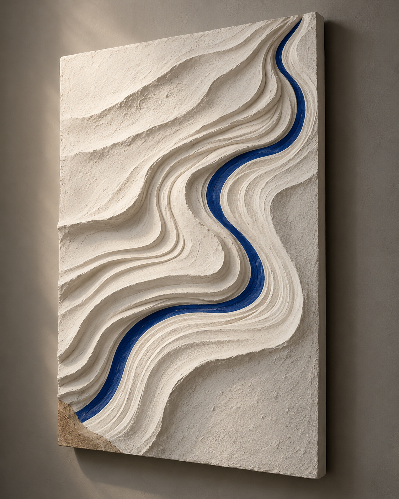
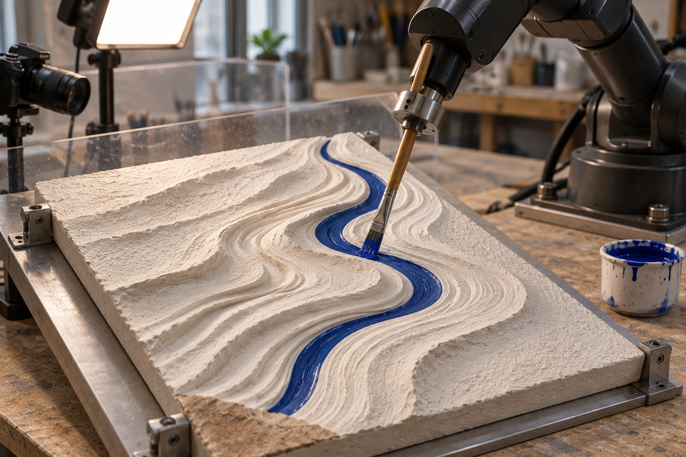
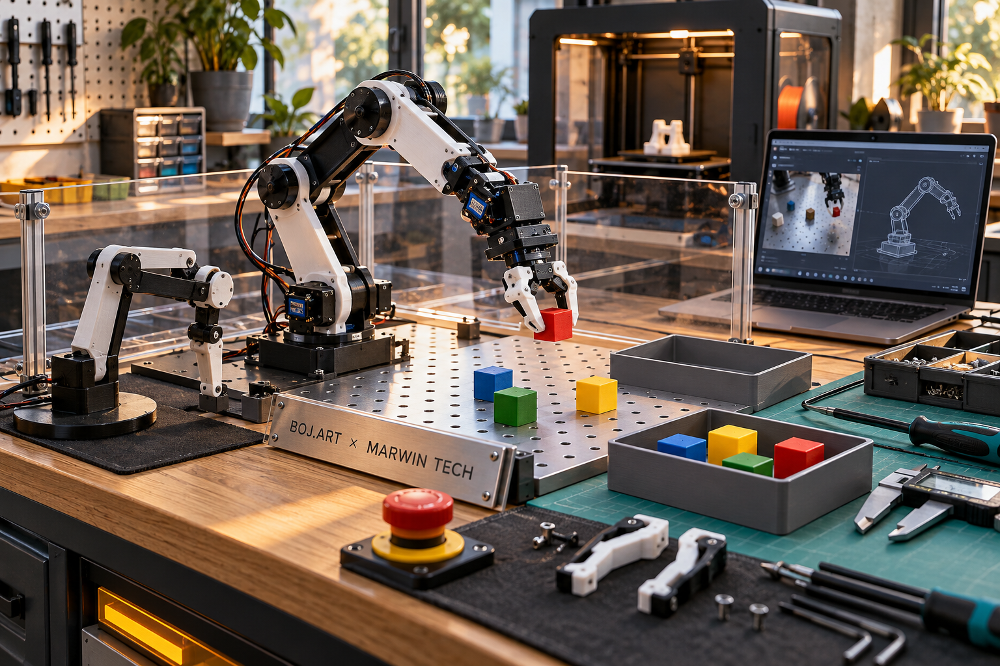

# Reprise des 59 conversations et des visuels — 4 novembre 2026

Résultat : les 59 conversations encore en attente ont été retentées. 9 lectures supplémentaires ont abouti, sans nouvelle mention directe de Carlone dans les échanges restitués. Trois visuels correspondant aux descriptions recherchées ont été extraits des PDF déjà présents. Les fichiers originaux de la bibliothèque ne sont pas récupérés ni identifiés par comparaison binaire.

## Conversations

| Contrôle | Résultat |
| --- | ---: |
| Conversations ciblées et retentées | 59 |
| Nouvelles lectures réussies | 9 |
| Refus de limitation ChatGPT | 47 |
| Lectures sans réponse après le délai borné | 3 |
| Total cumulé de conversations lues | 169 / 219 |
| Conversations encore sans lecture réussie | 50 |
| Nouvelles mentions directes de Carlone retrouvées | 0 |

Le contenu et les titres des conversations sans rapport retrouvé avec Carlone ne sont pas copiés dans le dépôt. Les réponses brutes restent conservées localement dans le dossier de travail de cette collecte. Le manifeste publié conserve des identifiants hachés, le statut et l’empreinte de chaque réponse pour les 59 tentatives.

Certaines lectures ne rendent que les derniers échanges et ne proposent aucun curseur vers les anciens messages. Un résultat sans mention directe ne démontre donc pas qu’une conversation entière ne parle jamais de Carlone. Aucun export intégral de l’historique n’a été obtenu.

## Visuels récupérés depuis les PDF

**Ces fichiers sont des extractions de versions incorporées aux PDF.** Ils sont récupérés sans nouvelle génération ni redimensionnement ; l’image incorporée au PDF peut avoir été modifiée avant sa création. L’association avec le nom recherché repose sur le contenu visible et le contexte du PDF, pas sur un hash du fichier Library original.

### Rivière ultramarine dans la pierre

- [Télécharger le PNG](../pour-carlone/visuels-recuperes-pdf/riviere-ultramarine-extrait-pdf.png) — 1122 × 1402 pixels.
- Source : [strates-proposition-artistique-v1.1.pdf](../pour-carlone/strates-proposition-artistique-v1.1.pdf), page 1.
- SHA-256 du PNG : `685c6099053cfd015384c277cd29a3b76dc2747346179edc4c5f33599362b178`.
- Référence Library candidate : `libfile_a0b1eafe059c819191a2ceeae4840883` ; identité du fichier original non vérifiée.

### Bras robotique peignant un relief fluvial bleu

- [Télécharger le PNG](../pour-carlone/visuels-recuperes-pdf/bras-peignant-relief-fluvial-extrait-pdf.png) — 1536 × 1024 pixels.
- Source : [strates-proposition-artistique-v1.1.pdf](../pour-carlone/strates-proposition-artistique-v1.1.pdf), page 3.
- SHA-256 du PNG : `dbeb92d36a99ab096093fe7e931a00f90056a2d3666e62870b5f47a9312326f1`.
- Référence Library candidate : `libfile_268510149a14819195ed5f3a1e1075f1` ; identité du fichier original non vérifiée.

### Bras robotique éducatif au cube rouge

- [Télécharger le PNG](../pour-carlone/visuels-recuperes-pdf/bras-educatif-cube-rouge-extrait-pdf.png) — 1536 × 1024 pixels.
- Source : [options-structure-remuneration-v5-2026-10-30.pdf](../interne/archives-marwin-tech/options-structure-remuneration-v5-2026-10-30.pdf), page 9.
- SHA-256 du PNG : `30c3512b1f68830d4aa85cad3e89dca86663565cc33717974e239c5cc4943228`.
- Référence Library candidate : `libfile_d6e569264d488191a791bf42fb8b6089` ; identité du fichier original non vérifiée.

## Quatrième visuel et accès aux originaux

« Atelier MARWIN TECH, art et robotique.png » (`libfile_0379adfb1434819195e92f6d572950cc`) reste sans correspondance certaine. Les autres images d’atelier déjà présentes ne sont pas substituées à ce fichier. Les 11 PDF documentaires examinés contiennent 22 images incorporées de taille suffisante ; trois pages sources ont été rendues et contrôlées visuellement. Les trois extractions ajoutées n’ont pas de doublon de pixels parmi les PNG déjà présents.

L’ouverture directe d’un lien Library exact dans le navigateur disponible a redirigé vers la connexion ChatGPT. Cette session navigateur ne permet donc pas de télécharger les originaux. Les quatre références originales restent signalées comme indisponibles ; trois disposent maintenant d’une alternative extraite d’un PDF.

## État du projet

Les visuels sont des illustrations IA, pas des photographies de réalisations ou une preuve de fonctionnement robotique. Aucun statut commercial, budget approuvé, achat, essai physique ou accord client n’est modifié par cette récupération.

[Manifeste complet et provenance](manifeste-reprise-59-et-visuels-2026-11-04.json) · [Étape de collecte précédente](index-complement-sessions-chatgpt-2026-11-04.md).
